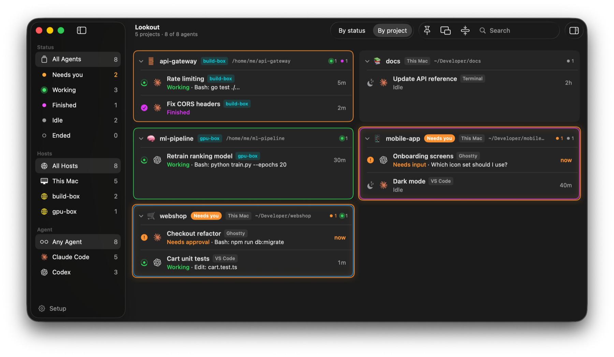
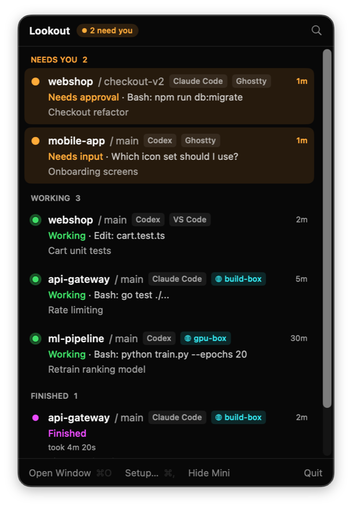
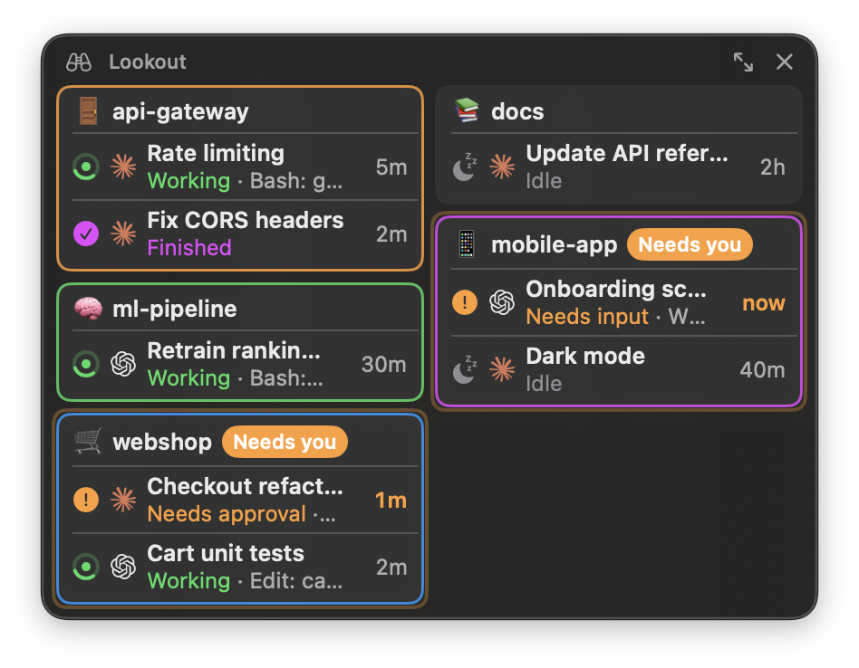
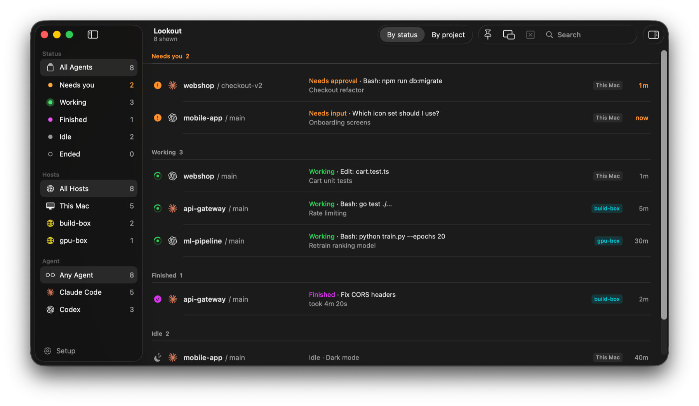

# Lookout

A macOS menu bar app that shows the state of every Claude Code and Codex agent on your Mac:
working, needs approval, needs input, or finished. It notifies you when one needs attention,
and clicking an agent jumps to its terminal. You keep launching agents however you like.



<p>
  
  
</p>

## Install

```sh
brew install --cask aslkhon/tap/lookout
```

Or download `Lookout-<version>.zip` from [Releases](https://github.com/aslkhon/lookout/releases)
and move `Lookout.app` to `/Applications`. Requires macOS 14 or later.

> Lookout isn't notarized yet, so macOS blocks it on first launch. Open
> **System Settings › Privacy & Security** and click **Open Anyway**, or run
> `xattr -dr com.apple.quarantine /Applications/Lookout.app`.

To uninstall, remove the hooks first (**Setup… → Remove Hooks**), then run
`brew uninstall --zap --cask lookout`.

## Build & run

```sh
./scripts/build-app.sh      # → build/Lookout.app + build/Lookout-<version>.zip (universal, ad-hoc signed)
open build/Lookout.app
swift test                  # state machine + installer tests (replays real hook payloads)
./scripts/screenshots.sh    # the dev build with made-up agents, for the screenshots above
```

On first launch Lookout shows a setup window that:

- adds hook entries to `~/.claude/settings.json`;
- adds hook entries to `~/.codex/hooks.json` and marks them trusted in `~/.codex/config.toml`
  (through `codex app-server`, so Codex writes its own config);
- asks for notification permission.

Existing hooks are kept, and each file is backed up as `<file>.lookout-backup-<timestamp>`.
To remove the hooks, open **Setup… → Remove Hooks**.

Clicking an agent jumps to its terminal. **Open Window** in the menu opens a dashboard, which
filters agents by status or project and shows details for the selected one. Projects can have
their own icon and background color.



**Compact mode** (⇧⌘M, or **Mini** in the menu) swaps the dashboard for a small window that floats
above other apps: your projects, with a row per agent that jumps to its terminal when clicked.

## Remote hosts (ssh)

Lookout can also watch agents on servers you ssh into, from VS Code Remote-SSH or a terminal.
Add a host in **Setup… → Remote Hosts** (aliases from `~/.ssh/config` are offered). The server needs:

- key-based ssh login that works without a prompt (Lookout runs `ssh -o BatchMode=yes`);
- `python3` (3.6+).

Adding a host uploads one script to `~/.lookout/bin/lookout-hook` on the server and adds its hooks
to `~/.claude/settings.json` and `~/.codex/hooks.json` there (with backups, as on the Mac). Lookout
then keeps one ssh connection open per host running `lookout-hook --watch`, which streams hook
events and the list of running agents. Nothing listens on a port, and the server never connects back.
When Lookout updates, it replaces an outdated helper on the next connection. **Remove** takes the
hooks out again.

Clicking a remote agent:

- **VS Code Remote-SSH**: focuses the window connected to that host and reveals the agent's
  terminal (needs the companion extension 0.2.0 or later; reload VS Code windows once after
  updating Lookout).
- **Ghostty**: finds the local `ssh` process carrying the session (by its TCP port, else by host
  name in its arguments) and focuses the Ghostty terminal running it.
- **Other terminals**: activates the app running that `ssh`.

Agents inside `tmux` or `screen` on the server are shown, but focusing only reaches them while the
session is attached in a local terminal.

## How it works

```
claude / codex ──hook──▶ ~/.lookout/bin/lookout-hook ──unix socket──▶ Lookout.app
```

- `lookout-hook` reads the hook JSON, adds the agent PID, TTY and host app (`__CFBundleIdentifier`),
  sends it to `~/.lookout/lookout.sock`, and exits 0 without printing anything.
  It takes about 20ms. If Lookout isn't running, it silently does nothing.
- `SessionReducer` (in `LookoutCore`) maps hook events to statuses. A 5s liveness check marks
  sessions as ended when their agent process exits.
- Clicking an agent:
  - **Ghostty**: focuses the terminal whose working directory matches, through Ghostty's
    AppleScript dictionary. macOS asks for Automation permission once.
  - **VS Code / Cursor**: Setup installs a small companion extension (`Extensions/vscode`). Each
    window publishes its folders and terminal shell PIDs to `~/.lookout/vscode/windows/`, so Lookout
    finds the agent's exact window and terminal by walking the agent's parent processes. Lookout
    reopens that window's folder (or, for multi-root workspaces, passes the workspace file to the
    editor's `code` CLI), which focuses it, and asks the extension to reveal the terminal tab.
    Without the extension it falls back to matching the agent's cwd against VS Code's saved
    window list.
  - **Anything else**: activates the host app.

Debug event flow with:

```sh
/usr/bin/log stream --level debug --predicate 'subsystem == "io.github.aslkhon.lookout"'
```
